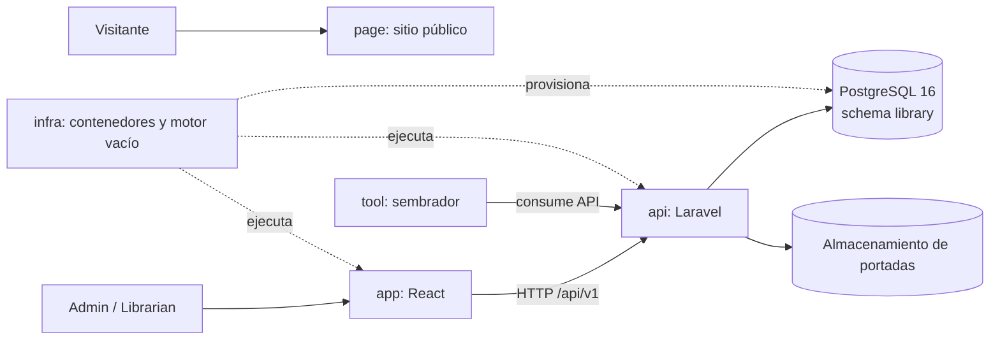
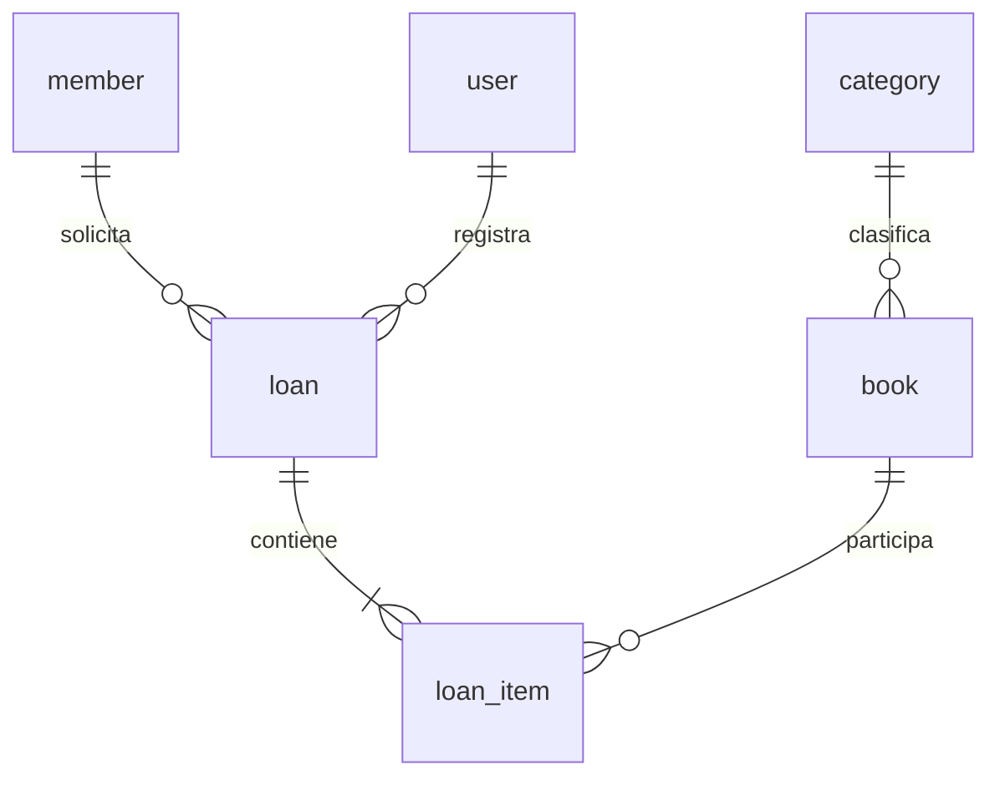

# Auditoría técnica documental — Manager Library

**Modo:** solo lectura sobre documentos fuente

**Fecha de elaboración:** 14 de octubre de 2026

**Alcance:** documentación, contratos, arquitectura, modelo de datos, ADRs, tareas y README de los seis repositorios.

**Fuera del alcance:** implementación de código, cambios de alcance, correcciones, migraciones, ejecución de pruebas, despliegues y modificaciones de cualquier repositorio.

## 1. Propósito del informe

Este informe consolida la auditoría técnica documental de *Manager Library*. Su objetivo es dejar una base clara para el trabajo posterior, identificando:

- qué exige actualmente la documentación;
- cómo se relacionan los seis repositorios;
- qué reglas son normativas;
- qué contradicciones o vacíos pueden producir implementaciones diferentes;
- qué dudas necesitan una decisión humana;
- qué validaciones deben realizarse cuando exista implementación.

El informe no redefine el producto. Las recomendaciones describen aclaraciones o verificaciones posibles, pero no autorizan cambios de alcance ni modificaciones automáticas.

## 2. Documentos y repositorios inspeccionados

### 2.1 Repositorios

Se inspeccionaron los seis repositorios locales:

| Repositorio | Propósito documentado | Estado observado |
|---|---|---|
| [docs](./) | Especificación y documentación normativa | Contiene `spec-python`, `spec-.net` y README |
| `api` | Backend Laravel | No está presente en este checkout |
| `app` | Frontend React | No está presente en este checkout |
| `page` | Sitio público estático | No está presente en este checkout |
| `infra` | Contenedores, red, volumen y PostgreSQL | No está presente en este checkout |
| `tool` | Sembrador de datos por API | No está presente en este checkout |

Los README confirman que los repositorios de implementación comienzan vacíos. Por tanto, la ausencia de código no se registra como defecto de los repositorios.

### 2.2 Documentación leída

Se revisaron las dos variantes documentales:

- [spec-.net](./spec-.net)
- [spec-python](./spec-python)

Dentro de cada variante se revisaron:

- `constitution.md`;
- `spec.md`;
- `architecture.md`;
- `arquitectura-panoramica.md`;
- `data-model.md`;
- `api-contract.md`;
- `plan.md`;
- `tasks.md`;
- los cuatro ADR de la carpeta `adr`.

El contrato HTTP, el modelo de datos, la especificación funcional y los ADR son equivalentes entre `spec-.net` y `spec-python`. Las diferencias principales están en el stack técnico de referencia.

## 3. Limitaciones de la auditoría

La auditoría no puede verificar todavía:

- si existe una API Laravel funcional;
- si las rutas coinciden con el contrato;
- si las migraciones crean exactamente las seis tablas;
- si las restricciones de PostgreSQL realmente existen;
- si se aplican los roles en el servidor;
- si el frontend consume correctamente la API;
- si el sembrador usa exclusivamente HTTP;
- si Docker Compose levanta todos los servicios;
- si las pruebas de concurrencia y seguridad pasan;
- si se filtran secretos, trazas o datos personales en ejecución.

Estas áreas quedan como validaciones pendientes, no como defectos confirmados.

## 4. Resumen ejecutivo

La documentación define un producto pequeño de gestión bibliotecaria con autenticación por roles, catálogo de libros, socios, préstamos, devoluciones, vencidos y un reporte de libros más prestados.

El contrato presenta una base sólida: separa negocio, API y modelo de datos; define códigos de error; establece reglas de privacidad; congela los datos históricos del préstamo; exige baja lógica de libros; y establece una estrategia de concurrencia para el último ejemplar.

Se identificaron cuatro asuntos principales que deben resolverse antes o durante la implementación:

1. El ADR de concurrencia exige un testigo de versión que no aparece en el modelo físico de `book`.
2. La ruta `GET /books/{id}/cover` se describe en el texto, pero no figura en la tabla principal de endpoints.
3. No está definido si el ISBN puede modificarse mediante `PUT /books/{id}`.
4. La ruta estática `/loans/overdue` puede entrar en conflicto con la ruta parametrizada `/loans/{id}` si el framework no aplica precedencia explícita.

Ninguno de estos puntos debe resolverse mediante suposiciones o ampliaciones del producto. Requieren aclaración, decisión de diseño o una regla de implementación verificable.

## 5. Alcance funcional documentado

### 5.1 Actores

La documentación define tres conceptos:

| Actor | Acciones | Acceso |
|---|---|---|
| `admin` | Gestiona libros y socios, crea bibliotecarios y consulta reportes | Token y rol administrativo |
| `librarian` | Registra préstamos y devoluciones, consulta catálogo, socios y vencidos | Token y rol operativo |
| Socio | Persona que recibe libros prestados | No inicia sesión |

El usuario `admin` inicial se crea durante el arranque usando variables de entorno. La API no puede otorgar el rol `admin` en ejecución.

### 5.2 Funcionalidades incluidas

- Inicio de sesión con token válido durante ocho horas.
- Alta de bibliotecarios.
- Catálogo de libros con cinco categorías fijas.
- Búsqueda de libros por título, autor y categoría.
- Portada opcional en JPG o PNG de hasta 2 MB.
- Alta y búsqueda de socios.
- Préstamos de uno a tres libros.
- Devolución de una línea de préstamo por operación.
- Cálculo de vencidos.
- Estado calculado del préstamo: `open`, `overdue` o `closed`.
- Reporte de libros más prestados.
- Baja lógica de libros.
- Concurrencia controlada al prestar el último ejemplar.

### 5.3 Funcionalidades explícitamente excluidas

La especificación excluye y declara fuera de reapertura:

- multas y pagos;
- reservas;
- renovaciones;
- correo y SMS;
- importación masiva;
- préstamos entre sedes;
- editorial, año e idioma del libro;
- eventos, colas, caché, microservicios y multi-tenencia.

Estas exclusiones deben respetarse durante la implementación y durante cualquier propuesta de corrección.

## 6. Mapa de arquitectura y dependencias



### 6.1 Responsabilidad de cada repositorio

#### `docs`

Es la fuente de requisitos, reglas de negocio, contratos, modelo de datos, decisiones de arquitectura y criterios de evidencia.

#### `api`

Debe implementar el backend en PHP con Laravel. Es responsable de:

- autenticación;
- autorización;
- validación;
- casos de uso;
- persistencia;
- transacciones;
- concurrencia;
- respuestas HTTP;
- almacenamiento de portadas.

#### `app`

Debe implementar el frontend React para las operaciones de login, catálogo, socios, préstamos, devoluciones, vencidos y reportes.

#### `page`

Debe ser un sitio público estático y no debe depender de la API.

#### `infra`

Debe levantar contenedores, red, volumen y motor PostgreSQL vacío. No debe convertirse en una segunda fuente de verdad del esquema.

#### `tool`

Debe crear datos de demostración consumiendo la API, nunca escribiendo directamente en PostgreSQL.

## 7. Contrato HTTP documentado

El contrato normativo principal es [api-contract.md](./spec-.net/api-contract.md). La variante Python contiene el mismo contrato en [api-contract.md](./spec-python/api-contract.md).

### 7.1 Convenciones generales

| Tema | Regla |
|---|---|
| Base | `/api/v1` |
| Formato | JSON UTF-8 |
| Campos | `snake_case` |
| Identificadores | UUID v4 como texto |
| Fechas | ISO 8601 UTC con `Z` |
| Autenticación | Bearer token salvo login y health |
| Paginación | `page` y `size`, máximo 50 |
| Errores | Campos y códigos en inglés; mensajes en español |

### 7.2 Cuerpo único de error

Todo error HTTP debe utilizar la misma estructura conceptual:

```json
{
  "code": "BOOK_NOT_AVAILABLE",
  "message": "No quedan ejemplares disponibles.",
  "details": [
    {
      "field": "items[0].book_id",
      "issue": "sin ejemplares"
    }
  ]
}
```

La respuesta no debe incluir trazas, SQL, rutas del servidor ni contraseñas.

### 7.3 Códigos de estado

| Estado | Uso documentado |
|---|---|
| 200 | Operación exitosa |
| 201 | Recurso creado |
| 204 | Operación exitosa sin cuerpo |
| 401 | Token ausente, inválido, vencido o credenciales inválidas |
| 403 | Rol insuficiente |
| 404 | Recurso inexistente o dado de baja |
| 409 | Conflicto de estado o concurrencia |
| 422 | Validación o regla de entrada inválida |

### 7.4 Inventario de endpoints

| Área | Método | Ruta | Rol |
|---|---|---|---|
| Salud | GET | `/health` | Público |
| Autenticación | POST | `/auth/login` | Público |
| Usuarios | POST | `/users` | `admin` |
| Categorías | GET | `/categories` | Autenticado |
| Libros | GET | `/books` | Autenticado |
| Libros | GET | `/books/{id}` | Autenticado |
| Libros | POST | `/books` | `admin` |
| Libros | PUT | `/books/{id}` | `admin` |
| Libros | DELETE | `/books/{id}` | `admin` |
| Portadas | PUT | `/books/{id}/cover` | `admin` |
| Portadas | DELETE | `/books/{id}/cover` | `admin` |
| Socios | GET | `/members` | `admin`, `librarian` |
| Socios | GET | `/members/{id}` | `admin`, `librarian` |
| Socios | POST | `/members` | `admin`, `librarian` |
| Préstamos | POST | `/loans` | `admin`, `librarian` |
| Préstamos | GET | `/loans` | `admin`, `librarian` |
| Préstamos | GET | `/loans/{id}` | `admin`, `librarian` |
| Préstamos | POST | `/loans/{loan_id}/items/{item_id}/return` | `admin`, `librarian` |
| Préstamos vencidos | GET | `/loans/overdue` | `admin`, `librarian` |
| Reportes | GET | `/reports/most-borrowed` | `admin` |

La ruta `GET /books/{id}/cover` debe considerarse parte del contrato aunque actualmente se mencione fuera de la tabla principal.

## 8. Modelo de datos documentado

El modelo define seis tablas dentro del esquema PostgreSQL `library`:

1. `category`;
2. `book`;
3. `member`;
4. `loan`;
5. `loan_item`;
6. `user`.

### 8.1 Relaciones



### 8.2 Reglas importantes del modelo

- `book.available_copies` siempre está entre cero y `total_copies`.
- `book.total_copies` es mayor o igual a uno.
- Los ISBN son únicos entre libros activos.
- Los socios no se eliminan.
- Los préstamos y sus líneas son históricos.
- Los libros utilizan baja lógica mediante `deleted_at`.
- `loan_item` congela título, ISBN y nombre de categoría.
- El estado del préstamo no se almacena.
- `days_late` no se almacena.
- Las portadas se representan mediante una clave opaca.
- Las contraseñas se almacenan únicamente como hash.
- El reporte no expone socios ni bibliotecarios.

### 8.3 Claves foráneas

La documentación establece:

- `book.category_id` → `category.id`, `RESTRICT`;
- `loan.member_id` → `member.id`, `RESTRICT`;
- `loan.loaned_by_user_id` → `user.id`, `RESTRICT`;
- `loan_item.loan_id` → `loan.id`, `CASCADE`;
- `loan_item.book_id` → `book.id`, `RESTRICT`.

La política protege el historial y evita que se eliminen entidades referenciadas por préstamos.

## 9. Reglas de negocio críticas

### 9.1 Préstamos

- Un préstamo pertenece a un solo socio.
- Debe contener entre uno y tres libros.
- No puede repetir el mismo libro.
- Cada línea descuenta exactamente un ejemplar.
- Si una línea no puede registrarse, no debe persistirse parcialmente el préstamo.
- El socio no puede superar tres libros sin devolver.
- Un socio con vencidos no puede recibir nuevos préstamos.
- La fecha de vencimiento es `loaned_at + 14 días`.
- El préstamo no se edita ni se elimina.

### 9.2 Devoluciones

- Se devuelve una línea por operación.
- Una línea devuelta no puede devolverse otra vez.
- La devolución incrementa una sola vez los ejemplares disponibles.
- El préstamo queda `closed` cuando todas sus líneas fueron devueltas.

### 9.3 Reportes

- El reporte recibe un rango obligatorio.
- El rango invertido produce `422`.
- Un rango sin préstamos devuelve una lista vacía.
- El agrupamiento usa los valores congelados en `loan_item`.
- Un cambio posterior en el catálogo no modifica el significado histórico.
- El reporte no se desglosa por socio ni por bibliotecario.

## 10. Hallazgos detallados

### 10.0 Estado de correcciones documentales

Durante la ejecución incremental de esta auditoría se corrigieron dos inconsistencias documentales inequívocas en ambas variantes del contrato:

- **DOC-002:** `GET /books/{id}/cover` ahora aparece en la tabla formal de endpoints.
- **DOC-004:** el contrato ahora establece que `/loans/overdue` debe resolverse antes que `/loans/{id}`.

Estas correcciones no agregan funcionalidades nuevas ni cambian permisos de negocio; hacen explícitas reglas que ya estaban implícitas en el contrato.

Siguen pendientes de decisión humana DOC-001, DOC-003, DOC-005 y DOC-006.

### DOC-001 — Testigo de versión no definido en el modelo físico

**Clasificación:** confirmado.

**Prioridad:** P1.

**Repositorio/documentos:** `docs`, ADR y modelo de datos.

**Evidencia:**

- [ADR-002](./spec-.net/adr/adr-002-concurrencia-optimista.md) indica que el libro lleva un testigo de versión (línea 6).
- [data-model.md](./spec-.net/data-model.md) enumera las columnas de `book` y no incluye `version`, `row_version` ni un campo equivalente (línea 63).
- La consulta de verificación del modelo tampoco define cómo comprobar dicho testigo.

**Comportamiento esperado:** la estrategia de concurrencia debe tener una representación explícita y verificable en el modelo, en la persistencia o en una regla atómica documentada.

**Riesgo actual:** la implementación puede usar mecanismos incompatibles entre sí: columna de versión, actualización condicional, bloqueo pesimista o reintento en aplicación.

**Causa probable:** el ADR se redactó con una decisión de persistencia que no se trasladó al modelo físico.

**Requisito afectado:** RNF-2 y ADR-002.

**Recomendación no ejecutada:** aclarar el mecanismo exacto sin cambiar la regla de negocio: ante dos préstamos del último ejemplar, exactamente uno debe ganar y el otro debe recibir `409 BOOK_NOT_AVAILABLE`.

**Prueba necesaria:** ejecutar dos solicitudes concurrentes contra un libro con un ejemplar y verificar una respuesta `201`, una respuesta `409` y disponibilidad final igual a cero.

**Pregunta pendiente:** ¿qué campo o condición garantiza el control optimista?

### DOC-002 — `GET /books/{id}/cover` no aparece en la tabla de endpoints — RESUELTO

**Clasificación:** confirmado.

**Prioridad:** P2.

**Evidencia:**

- [api-contract.md](./spec-.net/api-contract.md) lista `PUT` y `DELETE` para la portada (línea 107).
- [api-contract.md](./spec-.net/api-contract.md) menciona `GET /books/{id}/cover` como ruta necesaria para mostrar la portada (línea 121).

**Comportamiento esperado:** toda ruta consumida por el frontend debe estar en el inventario formal del contrato.

**Riesgo actual:** se puede implementar la carga y eliminación de portadas sin implementar su consulta.

**Requisito afectado:** CA-03.4 y el flujo de visualización de portada.

**Recomendación no ejecutada:** documentar el método, rol, formato de respuesta, `Content-Type`, comportamiento ante portada ausente y comportamiento para libro dado de baja.

**Prueba necesaria:** subir una portada, consultarla, eliminarla y confirmar `404` cuando no exista.

### DOC-003 — ISBN: creación definida, actualización ambigua

**Clasificación:** duda técnica.

**Prioridad:** P2.

**Evidencia:**

- [spec.md](./spec-.net/spec.md) exige ISBN al crear un libro (línea 43).
- [spec.md](./spec-.net/spec.md) exige 13 dígitos y unicidad entre activos (línea 44).
- [api-contract.md](./spec-.net/api-contract.md) describe `PUT /books/{id}` con título, autor, categoría y total, pero no ISBN (línea 105).

**Interpretaciones posibles:**

1. El ISBN es inmutable y solo se define durante la creación.
2. El ISBN se puede modificar, pero la documentación omitió el campo.
3. El ISBN debe actualizarse mediante una operación distinta.

**Riesgo:** la decisión afecta validación, unicidad parcial, historial y contrato del frontend.

**Decisión requerida:** confirmar cuál de las tres interpretaciones es válida.

**Responsable sugerido:** responsable funcional y responsable de API.

### DOC-004 — Precedencia entre `/loans/overdue` y `/loans/{id}` — RESUELTO

**Clasificación:** riesgo probable.

**Prioridad:** P2.

**Evidencia:**

- [api-contract.md](./spec-.net/api-contract.md) define `GET /loans/{id}` (línea 137).
- [api-contract.md](./spec-.net/api-contract.md) define `GET /loans/overdue` (línea 139).

**Riesgo:** algunos sistemas de routing pueden interpretar `overdue` como `{id}` si la ruta parametrizada tiene precedencia.

**Recomendación no ejecutada:** documentar la precedencia de la ruta estática o definir una restricción explícita para el identificador.

**Prueba necesaria:** solicitar `/api/v1/loans/overdue` y confirmar que nunca se procesa como detalle de préstamo.

### DOC-005 — Rol de consulta de portada no declarado en la tabla

**Clasificación:** duda técnica.

**Prioridad:** P3.

**Evidencia original:** antes de la corrección, la ruta `GET /books/{id}/cover` se mencionaba en [api-contract.md](./spec-.net/api-contract.md), pero no tenía una fila propia con rol (línea 121).

**Interpretaciones posibles:**

1. Requiere cualquier usuario autenticado, siguiendo la regla general.
2. Requiere `admin`.
3. Es pública porque las portadas son datos públicos.

La regla general de autenticación sugiere la primera opción, pero la ruta debería expresarlo explícitamente.

**Decisión requerida:** confirmar el nivel de acceso.

### DOC-006 — Semántica de `PUT /books/{id}` incompleta

**Clasificación:** observación.

**Prioridad:** P3.

**Evidencia:** el verbo `PUT` normalmente comunica reemplazo, mientras que el contrato solo enumera algunos campos en [api-contract.md](./spec-.net/api-contract.md) y no muestra un cuerpo de petición completo (línea 105).

**Riesgo:** el frontend y el backend pueden interpretar la operación como reemplazo total o actualización parcial.

**Recomendación no ejecutada:** documentar el cuerpo obligatorio, los campos inmutables, la respuesta y el comportamiento de campos omitidos.

## 11. Seguridad documental

La documentación define controles adecuados que deben mantenerse:

- las contraseñas no viajan ni se almacenan en claro;
- el hash no aparece en respuestas;
- la clave JWT llega desde el entorno;
- el `.env` real no se versiona;
- el token contiene `sub` y `role`, pero no datos personales;
- cada endpoint aplica autorización por rol;
- un `403` no debe revelar si el recurso existe;
- CORS se limita al origen configurado;
- las portadas validan el tipo por contenido y no solo por extensión;
- los errores no exponen trazas, SQL ni rutas internas.

No es posible comprobar la aplicación real porque los repositorios de implementación contienen únicamente README.

## 12. Base de datos y persistencia

### 12.1 Decisiones coherentes

La documentación mantiene coherentemente estas decisiones:

- seis tablas;
- PostgreSQL 16;
- esquema `library`;
- migraciones como propietarias del DDL;
- `infra` con motor vacío;
- cinco categorías sembradas por migración;
- administrador inicial creado por la aplicación desde variables de entorno;
- baja lógica de libros;
- retención indefinida de préstamos;
- eliminación física únicamente del binario de portada después de anular su referencia.

### 12.2 Punto que requiere aclaración

El mecanismo de concurrencia de [ADR-002](./spec-.net/adr/adr-002-concurrencia-optimista.md) debe alinearse con [data-model.md](./spec-.net/data-model.md). Esta es la principal inconsistencia entre una decisión arquitectónica y el modelo físico.

## 13. Revisión de nomenclatura

La nomenclatura técnica está mayoritariamente en inglés:

| Concepto de negocio | Nombre documentado |
|---|---|
| usuario | `user` |
| libro | `book` |
| categoría | `category` |
| socio | `member` |
| préstamo | `loan` |
| línea de préstamo | `loan_item` |
| portada | `cover_key` |
| disponible | `available_copies` |

La documentación y los mensajes al usuario están en español, mientras que código, rutas, columnas y códigos de error están en inglés. Esta separación es coherente con la constitución y no requiere una normalización adicional.

No se propone renombrar entidades, tablas, endpoints ni conceptos de negocio.

## 14. Comparación entre `spec-.net` y `spec-python`

### 14.1 Elementos equivalentes

Los siguientes documentos son equivalentes en negocio y contrato:

- `spec.md`;
- `api-contract.md`;
- `data-model.md`;
- los cuatro ADR;
- la lista de tareas funcionales.

### 14.2 Diferencias técnicas esperadas

| Área | Python | .NET |
|---|---|---|
| Runtime | Python 3.12 | .NET 8 / C# 12 |
| HTTP | FastAPI | ASP.NET Core Minimal API |
| Persistencia | SQLAlchemy 2 + Alembic | EF Core 8 + migraciones EF |
| Hash | Argon2id | BCrypt factor 12 |
| Pruebas de arquitectura | import-linter | NetArchTest |
| Pruebas | pytest | xUnit |

Estas diferencias no cambian el contrato del producto ni autorizan a implementar Python o .NET en el reto, cuyo stack objetivo está documentado como React + Laravel.

## 15. Registro de dudas técnicas

| ID | Pregunta | Componentes | Riesgo | Decisión requerida |
|---|---|---|---|---|
| DT-001 | ¿Dónde vive el testigo de versión de `book`? | ADR-002, data-model, migraciones | Concurrencia no verificable | Responsable técnico |
| DT-002 | ¿Debe aparecer `GET /books/{id}/cover` como endpoint formal? | API, app | Funcionalidad omitida | Responsable de API |
| DT-003 | ¿El ISBN es modificable? | spec, API, modelo | Contratos incompatibles | Responsable funcional y API |
| DT-004 | ¿Qué precedencia tienen `/loans/overdue` y `/loans/{id}`? | Routing Laravel, API | Ruta incorrecta | Responsable de backend |
| DT-005 | ¿Qué rol puede consultar una portada? | API, seguridad, app | Acceso demasiado amplio o restrictivo | Responsable de seguridad/API |
| DT-006 | ¿`PUT /books/{id}` es reemplazo total o actualización parcial? | API, app | Datos omitidos o sobrescritos | Responsable de API |

## 16. Validaciones realizadas

Se realizaron únicamente comprobaciones no destructivas:

- inventario de archivos de los seis repositorios;
- revisión de README;
- comprobación de rama actual;
- comprobación de estado local de Git;
- lectura de documentos normativos;
- comparación de las variantes Python y .NET;
- búsqueda cruzada de rutas, tablas, restricciones, roles, secretos y decisiones de concurrencia.

No se ejecutaron:

- migraciones;
- pruebas;
- servidores;
- Docker Compose;
- sembradores;
- comandos de instalación;
- consultas contra bases de datos;
- análisis dinámicos o pruebas intrusivas.

## 17. Plan de verificación posterior

Cuando exista implementación, la validación debería realizarse en este orden:

1. Confirmar que Laravel respeta `/api/v1` y todas las rutas del contrato.
2. Verificar autenticación, expiración de token y autorización por rol.
3. Verificar el cuerpo único de error para `401`, `403`, `404`, `409` y `422`.
4. Comparar migraciones contra las seis tablas y las restricciones documentadas.
5. Resolver y probar el mecanismo de concurrencia de DOC-001.
6. Probar baja lógica, ISBN parcial y preservación del historial.
7. Probar congelamiento de título, ISBN y categoría en `loan_item`.
8. Probar rutas de portada, incluida la consulta omitida de la tabla.
9. Ejecutar la prueba de rutas conflictivas `/loans/overdue` y `/loans/{id}`.
10. Verificar que `tool` usa la API y no SQL directo.
11. Levantar `infra` con una base vacía y un solo comando.
12. Ejecutar el recorrido frontend: login → catálogo → préstamo → devolución → vencidos → reporte.

## 18. Recomendaciones no ejecutadas

1. Aclarar el testigo de versión sin alterar la regla funcional de concurrencia.
2. Completar la tabla de endpoints con `GET /books/{id}/cover`.
3. Definir formalmente la mutabilidad del ISBN.
4. Documentar precedencia o restricciones de rutas para `/loans/overdue`.
5. Especificar rol, `Content-Type` y respuestas de la consulta de portada.
6. Completar el cuerpo de petición y semántica de `PUT /books/{id}`.
7. Mantener la separación entre contrato común y decisiones tecnológicas de cada stack de referencia.
8. No añadir funciones fuera del alcance documentado.

## 19. Declaración final

La auditoría documental queda completada respecto de la evidencia disponible. La especificación presenta una arquitectura y un alcance claros, pero contiene vacíos que deben resolverse antes de considerar el contrato completamente cerrado.

Los asuntos más importantes son la ausencia del testigo de versión en el modelo físico, la ruta de consulta de portada no formalizada y la ambigüedad sobre la modificación del ISBN.

No se modificaron los documentos fuente, no se modificó el alcance y no se ejecutó ninguna corrección. Las decisiones pendientes permanecen bajo responsabilidad del equipo funcional y técnico.
